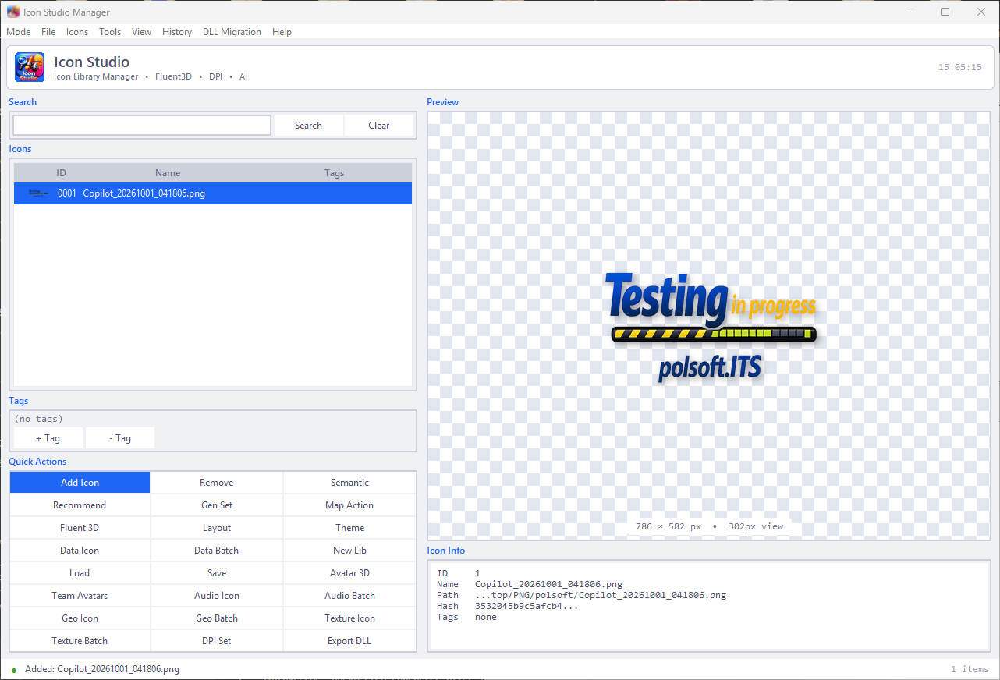

<div align="center">



# IconStudio

**Professional icon studio for Windows — convert, manage and generate icons with AI.**

[](.github/workflows/test.yml)
[](https://www.python.org/)
[](#license)
[](#)

[English](README.md) | [Polski](docs/readme.pl.md)

</div>

---

## ✨ Features

| | |
|---|---|
| 🖼️ **Multi-resolution ICO** | Convert any image to a multi-resolution ICO (16–256 px) with Lanczos scaling |
| ✂️ **Smart Crop & Auto-Pad** | Detects the main object and centers it — no more off-center icons |
| 🎯 **Pixel-Perfect Mode** | Special sharpening, gamma and contrast for 16×16 / 32×32 icons |
| 📊 **Quality Score** | 0–100 rating (sharpness, contrast, alpha, small-size readability) |
| 👀 **Context Preview** | See your icon in a folder, taskbar and browser tab before shipping |
| 📐 **Size Presets** | favicon · windows · macos · android · ios · minimal · full |
| 👁️ **Folder Watching** | Drop a file in a folder → it converts automatically |
| 📦 **Batch Processing** | Convert entire folders in one click |
| 🍎 **ICNS Export** | Native macOS icon format |
| 🤖 **AI Integration** | Classification, semantic analysis, text-to-icon and Fluent 3D generation |
| 🧰 **DLL Export** | Pack your library into a Windows PE resource DLL |
| 🕐 **History** | Snapshot / restore / diff your icon library |

## 🚀 Getting Started

### Prerequisites

- Python 3.11+
- pip

### Installation

```bash
git clone <repository-url>
cd IconStudio
pip install -r requirements.txt
```

### Run

```powershell
# GUI
python main.py
# or
python run.py

# Windows shortcut
iconstudio.bat
```

## 💡 Usage

### GUI Modes

- **Library** — manage icons, tags, search, AI recommendations
- **Editor** — layers, transforms, presets (fluent_light, monochrome, pastel…)
- **Converter** — batch image → ICO / PNG set / Favicon / ICNS

### Command Line

Full toolset:

```bash
python -m iconstudio.cli --help

# Examples
python main.py add my_icon.png "My Icon"
python main.py semantic 1
python main.py exportdll icons.dll
python main.py fluent3d "blue gear icon" ./out
```

Quick conversion:

```bash
python -m iconstudio.cli_simple input.png output.ico --sizes 16,32,48,256
```

### Python API

```python
from iconstudio.api import IconStudio

studio = IconStudio()
studio.load_library("library.json")
studio.add_icon("my_icon.png")
print(studio.analyze_ico("my_icon.ico"))
```

## 🧪 Testing

```bash
pip install pytest pytest-cov
pytest tests/ --cov=iconstudio
```

## 📁 Project Structure

```
IconStudio/
├── main.py                  # Entry point (GUI / CLI dispatch)
├── run.py                   # Thin launcher
├── iconstudio/
│   ├── api.py               # Public Python API
│   ├── cli.py               # Full CLI (40+ commands)
│   ├── cli_simple.py        # One-shot conversion CLI
│   ├── gui/                 # Tkinter GUI (app, editor, converter, dialogs)
│   └── iconlib/             # Engine: conversion, AI, DPI, DLL, themes…
├── tests/                   # Pytest suite
├── docs/                    # Docs, Polish README, quick description
└── requirements.txt
```

## 🤝 Contributing

1. Fork the repository
2. Create a feature branch (`git checkout -b feature/amazing-feature`)
3. Run the tests (`pytest tests/`)
4. Commit and open a Pull Request

## 📄 License

Distributed under the MIT License. See `LICENSE` for details.

---

<div align="center">

Made with ❤️ using Python and Tkinter

</div>

---

<small>

author: Sebastian Januchowski  
company: polsoft.ITS™  
email: [polsoft.its@mail.com](mailto:polsoft.its@mail.com)  
GitHub: [https://github.com/polsoft-it](https://github.com/polsoft-it)

</small>
