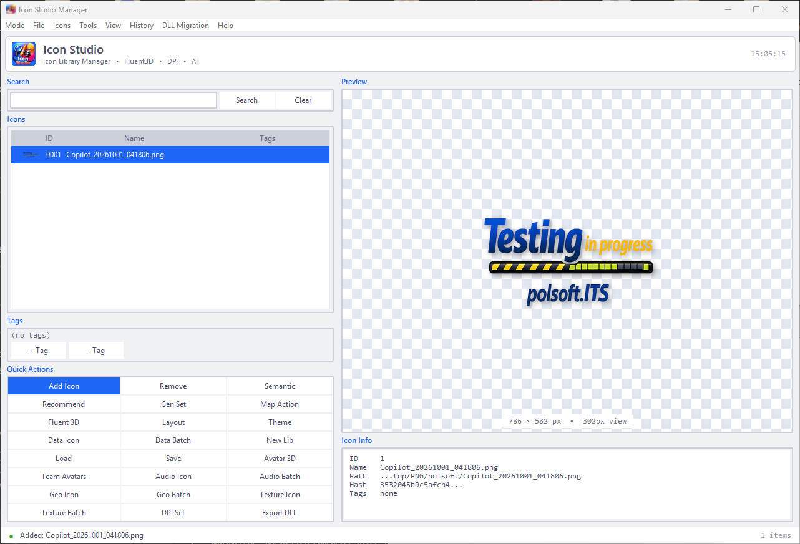

<div align="center">



# IconStudio

**Profesjonalne studio ikon dla Windows — konwersja, zarządzanie i generowanie ikon z AI.**

[](../.github/workflows/test.yml)
[](https://www.python.org/)
[](#)

**[English](../README.md)** | **[Polski](readme.pl.md)**

</div>

---

## ✨ Funkcje

| | |
|---|---|
| 🖼️ **Multi-rozdzielczościowe ICO** | Konwersja dowolnego obrazu do ICO 16–256 px (Lanczos) |
| ✂️ **Smart Crop i auto-wypełnianie** | Wykrywa główny obiekt i centruje go — ikony zawsze wyśrodkowane |
| 🎯 **Tryb Pixel-Perfect** | Specjalne wyostrzenie, gamma i kontrast dla ikon 16×16 / 32×32 |
| 📊 **Ocena jakości** | Wynik 0–100 (ostrość, kontrast, alfa, czytelność w małych rozmiarach) |
| 👀 **Podgląd kontekstowy** | Zobacz ikonę w folderze, pasku zadań i karcie przeglądarki |
| 📐 **Presety rozmiarów** | favicon · windows · macos · android · ios · minimal · full |
| 👁️ **Obserwacja folderu** | Wrzuć plik do folderu → konwersja odbywa się automatycznie |
| 📦 **Przetwarzanie wsadowe** | Konwersja całych folderów jednym kliknięciem |
| 🍎 **Eksport ICNS** | Natywny format ikon macOS |
| 🤖 **Integracja z AI** | Klasyfikacja, analiza semantyczna, text-to-icon i generowanie Fluent 3D |
| 🧰 **Eksport DLL** | Spakuj bibliotekę do Windows PE resource DLL |
| 🕐 **Historia** | Snapshot / przywracanie / diff biblioteki ikon |

## 🚀 Pierwsze kroki

### Wymagania

- Python 3.11+
- pip

### Instalacja

```bash
git clone <adres-repozytorium>
cd IconStudio
pip install -r requirements.txt
```

### Uruchomienie

```powershell
# GUI
python main.py
# lub
python run.py

# Skrót na Windows
iconstudio.bat
```

## 💡 Użycie

### Tryby GUI

- **Biblioteka** — zarządzanie ikonami, tagi, wyszukiwanie, rekomendacje AI
- **Edytor** — warstwy, transformacje, presety (fluent_light, monochrome, pastel…)
- **Konwerter** — wsadowa konwersja obraz → ICO / zestaw PNG / Favicon / ICNS

### Wiersz poleceń

Pełny zestaw narzędzi:

```bash
python -m iconstudio.cli --help

# Przykłady
python main.py add moja_ikona.png "Moja ikona"
python main.py semantic 1
python main.py exportdll ikony.dll
python main.py fluent3d "niebieska ikona zębatki" ./out
```

Szybka konwersja:

```bash
python -m iconstudio.cli_simple wejscie.png wyjscie.ico --sizes 16,32,48,256
```

### API w Pythonie

```python
from iconstudio.api import IconStudio

studio = IconStudio()
studio.load_library("library.json")
studio.add_icon("moja_ikona.png")
print(studio.analyze_ico("moja_ikona.ico"))
```

## 🧪 Testy

```bash
pip install pytest pytest-cov
pytest tests/ --cov=iconstudio
```

## 📁 Struktura projektu

```
IconStudio/
├── main.py                  # Punkt wejścia (GUI / CLI)
├── run.py                   # Cienki launcher
├── iconstudio/
│   ├── api.py               # Publiczne API w Pythonie
│   ├── cli.py               # Pełny CLI (40+ komend)
│   ├── cli_simple.py        # CLI szybkiej konwersji
│   ├── gui/                 # GUI Tkinter (app, editor, converter, dialogs)
│   └── iconlib/             # Silnik: konwersja, AI, DPI, DLL, motywy…
├── tests/                   # Testy pytest
├── docs/                    # Dokumentacja, polski README, krótki opis
└── requirements.txt
```

## 🤝 Współtworzenie

1. Zrób fork repozytorium
2. Utwórz gałąź funkcji (`git checkout -b feature/niesamowita-funkcja`)
3. Uruchom testy (`pytest tests/`)
4. Zatwierdź zmiany i otwórz Pull Request

## 📄 Licencja

Projekt dystrybuowany na licencji MIT. Szczegóły w pliku `LICENSE`.

---

<div align="center">

Stworzone z ❤️ w Pythonie i Tkinter

</div>

---

<small>

author: Sebastian Januchowski  
company: polsoft.ITS™  
email: [polsoft.its@mail.com](mailto:polsoft.its@mail.com)  
GitHub: [https://github.com/polsoft-it](https://github.com/polsoft-it)

</small>
